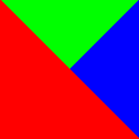
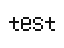
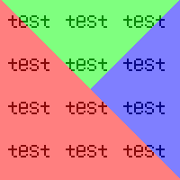

# WatermarkTool


Консольная утилита на C++17, которая накладывает водяной знак на BMP-изображение.

## Содержание

- [Используемые технологии](#используемые-технологии)
- [Цели](#цели)
- [Как запустить проект](#как-запустить-проект)
- [Как это работает](#как-это-работает)
- [Поддерживаемый формат](#поддерживаемый-формат)
- [Требования](#требования)
- [Пример](#пример)

## Используемые технологии

- C++17, чтение и запись файлов через `std::ifstream` / `std::ofstream` в бинарном режиме
- Git для командной разработки
- автоматическая сборка и тесты в GitHub Actions

## Цели

-	Научиться разбивать большую задачу на части и работать в команде над общим кодом.
-	Освоить практическое использование Git: создание локального репозитория, коммиты, слияние изменений, разрешение конфликтов, отправка изменений на GitHub.
-	Получить опыт использования GitHub для совместной разработки: совместный репозиторий, Pull Request’ы (по желанию), код-ревью.
-	Закрепить знание С++ в части работы с файловым вводом-выводом (бинарные файлы), создании и использовании классов, манипуляции с массивами байтов.
-	Разобраться с форматом изображений BMP: чтение заголовка файла, пиксельных данных; научиться сохранять изменённое изображение в правильном формате.
-	Реализовать простой алгоритм наложения водяного знака на изображение (визуальное наложение, чтобы исходное изображение оставалось видимым).
-	Настроить простейший CI (Continuous Integration) с помощью GitHub Actions для автоматической сборки и тестирования проекта при обновлениях репозитория.
-	Оформить документацию в файле README, описав работу программы, структуру проекта, инструкции по сборке и использованию, а также результаты тестовых запусков.

## Как запустить проект

### Сборка

Все команды выполняются из корня репозитория.

```bash
clang++ -std=c++17 -Wall -Wextra -O2 -o build     itmo_bmp/WatermarkTool/main.cpp\
     itmo_bmp/WatermarkTool/ArgumentParser.cpp\
     itmo_bmp/WatermarkTool/Watermark.cpp\
     itmo_bmp/BMPImage/BMPImage.cpp
```

Вместо `g++` можно использовать `clang++`.

### Запуск

```bash
./build <основное.bmp> <водяной_знак.bmp> <результат.bmp>
```

| Аргумент | Что это |
|---|---|
| `<основное.bmp>` | исходное изображение, 24-битный BMP |
| `<водяной_знак.bmp>` | водяной знак, 24-битный BMP, не больше исходного по обеим сторонам |
| `<результат.bmp>` | куда сохранить результат; расширение должно быть `.bmp` |

## Как это работает

### Алгоритм смешания пикселей

Цвет каждого пикселя результата вычисляется как **среднее** цветов исходного изображения
и водяного знака, отдельно по каждому каналу (R, G, B):

```
результат = (исходный + знак) / 2
```

### Алгоритм наложения

Водяной знак **повторяется плиткой** по всему изображению. Пиксель `(x, y)` основного
изображения смешивается с пикселем `(x % w_знака, y % h_знака)` водяного знака.
Например, для знака 2×2 и изображения 5×4:

```
Основное изображение 5×4        Какой пиксель знака берётся
┌───┬───┬───┬───┬───┐           ┌───┬───┬───┬───┬───┐
│   │   │   │   │   │           │ A │ B │ A │ B │ A │
├───┼───┼───┼───┼───┤           ├───┼───┼───┼───┼───┤
│   │   │   │   │   │           │ C │ D │ C │ D │ C │
├───┼───┼───┼───┼───┤           ├───┼───┼───┼───┼───┤
│   │   │   │   │   │           │ A │ B │ A │ B │ A │
├───┼───┼───┼───┼───┤           ├───┼───┼───┼───┼───┤
│   │   │   │   │   │           │ C │ D │ C │ D │ C │
└───┴───┴───┴───┴───┘           └───┴───┴───┴───┴───┘
                                Знак:  A B
                                       C D
```

Водяной знак **не может быть больше** основного изображения ни по ширине, ни по высоте.
В этом случае программа сообщает об ошибке.

## Поддерживаемый формат

Только **несжатый 24-битный BMP**:

- файлы со стандартным порядком строк (снизу вверх) и с отрицательной высотой
  (сверху вниз);
- строки выровнены до 4 байт, пропуски учитываются при чтении и записи;
- результат всегда сохраняется как 24-битный BMP.

Другие форматы (8, 16, 32 бита, сжатие RLE и т. д.) отклоняются с сообщением об ошибке.


## Требования

- **ОС:** Linux или macOS (код использует POSIX-заголовки `unistd.h` и `strings.h`);
- **Компилятор** с поддержкой C++17 и `std::filesystem`:
  g++ 9 или новее, либо clang++ 10 или новее;
- **Для тестов:** библиотека Google Test (`libgtest-dev` на Ubuntu/Debian,
  `brew install googletest` на macOS).

## Пример

Исходное изображение `photo.bmp` (640×480, синий фон) и водяной знак `logo.bmp`
(64×48, белый):

**Исходное изображение**</br>
</br>
**Водяной знак**</br>
</br>

```bash
./build images/photo.bmp images/logo.bmp images/result.bmp
```

Вывод:

```
[WatermarkTool:INFO] Загружен файл (основное изображение): photo.bmp, 640x480
[WatermarkTool:INFO] Загружен файл (водяной знак): logo.bmp, 64x48
[WatermarkTool:INFO] Водяной знак успешно наложен, результат: result.bmp
```
**Резултат**</br>
</br>


### Что происходит в особых случаях

| Ситуация | Поведение |
|---|---|
| Файл результата уже существует | программа спросит `Перезаписать? (y/n)`; при ответе, отличном от `y`, или закрытом вводе операция отменяется |
| Папки выходного пути нет | папки создаются автоматически |
| Водяной знак больше изображения | ошибка `водяной знак больше основного изображения`, файл не создаётся |
| Входной файл не найден, не `.bmp`, повреждён или не 24-битный | ошибка с указанием, какой именно файл виноват |
| Неверное число аргументов | сообщение об ошибке |

### Коды завершения

- `0` - водяной знак наложен, результат сохранён;
- `1` - любая ошибка либо отмена перезаписи пользователем.
